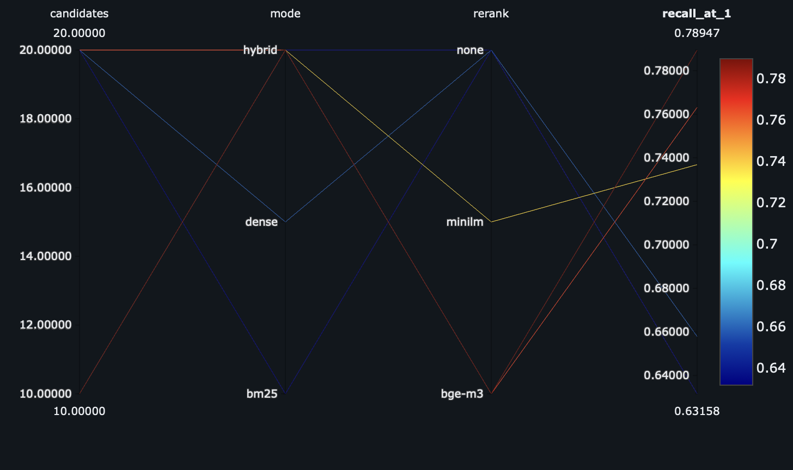
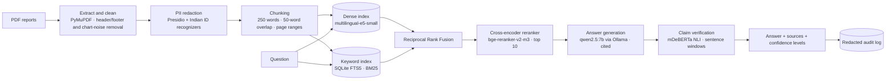
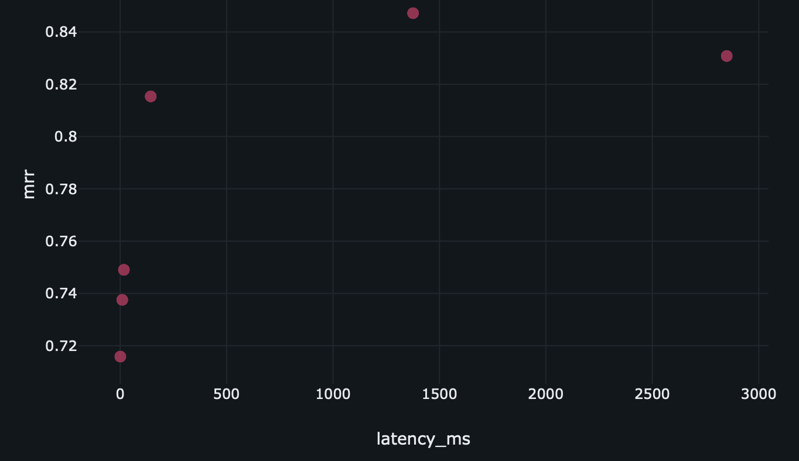

# Offline DocQA — Auditable, Multilingual Document Q&A on a Laptop

[](https://github.com/itsmittalharshit/offline-docqa/actions/workflows/ci.yml)

A retrieval-augmented question-answering system for internal reports that runs **entirely offline** on a MacBook Air M4 (16 GB). No document or question ever leaves the machine.

Every answer comes with:
- **page-level citations**
- an **automatic claim check**, shown as ✅ verified / ⚠️ weak / ❌ unsupported
- a **redacted audit-log entry**

It answers questions in **English and Hindi** over English documents, and refuses ("I could not find this in the documents") when the answer isn't there.

Built from scratch in Python as a learning project. The core pipeline uses no RAG framework. Every component was measured against a hand-labelled evaluation set before being kept.

---

## Results at a glance

| | Result |
|---|---|
| **Corpus** | 3 RBI reports (206 pages, 331 chunks) |
| **Evaluation set** | 42 hand-labelled questions: 38 answerable + 4 unanswerable; factual, recommendation, paraphrase and Hindi |
| **Retrieval** (hybrid + reranker) | **Recall@1 0.79 · Recall@10 1.00 · MRR 0.847**, up from MRR 0.749 with dense search alone |
| **Hallucination on unanswerable questions** | **0 / 4** answered |
| **False refusals** | 1 / 38 |
| **Answer language matches question** | 100 % (fixed a Chinese reply to a Hindi question) |
| **Invented citation numbers** | 0 % in evaluation (was 8 % before prompt v3) |
| **Claim verifier** | AUROC ≈ 0.90 at ranking wrong answers below correct ones |
| **Own LSH vector index** | 2.6× faster than brute force at 0.98 tie-aware recall on 200k vectors |
| **CI quality gate** | Caught a deliberately degraded retrieval change that passed all unit tests |

The full experiment log, with every configuration tried, failed ideas, confounds and caveats, is in [`eval/results.md`](eval/results.md).



---

## How it works



| Stage | What it does | Why |
|---|---|---|
| **Ingestion** | Block-level PDF extraction, then paragraphs are rebuilt with punctuation, list-marker and caption rules. Repeated headers and footers are found by frequency (digits normalised before hashing), chart-axis noise is removed by letter ratio, and near-empty pages are flagged. | The raw PDFs stored every line as a separate block, and leaked chart axes and page headers into the text. |
| **Privacy** | Emails, phone numbers, PAN, Aadhaar (only with context words), cards and IBANs are redacted **before** chunking. Names of public officials are deliberately kept. | PII must never reach any index. Redacting names would destroy correct answers about public reports, so this is a documented policy choice. |
| **Hybrid retrieval** | e5-small dense search + SQLite BM25, fused with RRF. BM25 receives only the Latin-script words of a query. | Dense search handles paraphrases and cross-lingual queries; BM25 handles exact terms and numbers. Hindi questions that contain English terms still benefit from BM25. |
| **Reranking** | A cross-encoder re-scores the top 10 candidates. | The biggest single quality gain (R@1 0.63 → 0.79). Ten candidates beat 20 at half the latency, because stage-1 Recall@10 is already 1.00. |
| **Generation** | A local 7B model at temperature 0, given 5 numbered passages. The language instruction and citation format are placed *after* the question. | Prompt v3 removed language drift and invented citations. A longer, stricter prompt (v2) made a 7B model worse. |
| **Claim check** | Each answer sentence is tested for entailment against overlapping 2-sentence windows of its cited passages. Abbreviations and number formats are handled. | Catches plausible-sounding unsupported claims, such as an invented expansion of "SPD". Three confidence levels instead of one cutoff, because no threshold separated wrong from correct answers. |
| **Audit** | One JSON line per question: redacted question and answer, retrieved chunk IDs and pages, citations, claim levels, configuration, timings. | Any answer can be reconstructed and explained later. |

---

## Key experiments

All numbers are on eval set v2.2 (38 answerable questions). Full tables are in [`eval/results.md`](eval/results.md).

| Retrieval configuration | R@1 | R@10 | MRR | Latency |
|---|---|---|---|---|
| BM25 only | 0.63 | 0.95 | 0.716 | 1 ms |
| Dense only (e5-small) | 0.66 | 0.92 | 0.749 | 18 ms |
| Hybrid (RRF) | 0.63 | **1.00** | 0.738 | 10 ms |
| Hybrid + minilm reranker (top 10) | 0.74 | 1.00 | 0.815 | 0.14 s |
| Hybrid + bge reranker (top 20) | 0.76 | 0.97 | 0.831 | 2.8 s |
| **Hybrid + bge reranker (top 10)** | **0.79** | **1.00** | **0.847** | **1.4 s** |

**Findings worth knowing:**
- **A bigger embedding model was not better.** bge-m3 (568M parameters) never beat e5-small (118M) on top ranks, and was about 10× slower.
- **The reranker can hurt individual questions.** Promotions of neighbouring chunks also exposed incomplete labels in the eval set.
- **The heuristic correctness metric was wrong in both directions.** It passed a hallucinated acronym expansion and a Chinese answer, and failed correct Devanagari names. Adding script detection and number normalisation fixed the measurable cases.
- **The NLI verifier went through two versions.**
  - Whole-chunk premises caught all 5 wrong answers but raised 10 false alarms.
  - Sentence windows reduced the false alarms to 2, but caught only 2 wrong answers.
  - The final design uses three levels: ❌ < 0.5 ≤ ⚠️ < 0.9 ≤ ✅.

### Own LSH index (`src/lsh.py`)

Random-hyperplane LSH with multiple tables, multi-probe and **mean-centering**.

**Why centering matters:** e5 embeddings are anisotropic. Without centering, the probed buckets contained 94 % of the corpus, making the index slower than brute force.

**Benchmark** (200k synthetic vectors, 42 real queries):

| Method | Tie-aware recall@10 | ms / query |
|---|---|---|
| Brute force (NumPy) | 1.000 | 5.5 |
| LSH, 12 bits × 8 tables | 0.983 | 2.1 |
| FAISS HNSW | 0.931 | 0.16 |

**At 331 real chunks the app keeps brute force:** it is instant and exact, while LSH lowered R@1 from 0.79 to 0.68. An approximate index pays off only at scale.

---

## Quick start (macOS, Apple Silicon)

### 1. Environment

```bash
git clone https://github.com/itsmittalharshit/offline-docqa.git
cd offline-docqa
python3 -m venv .venv
source .venv/bin/activate
python -m pip install -r requirements-lock.txt
python -m spacy download en_core_web_sm
```

### 2. Local LLM

```bash
brew install ollama
brew services start ollama
ollama pull qwen2.5:7b
```

### 3. Documents

The source PDFs are public RBI reports, but RBI's website blocks scripted downloads.
1. Download them **in a browser** from the URLs in [`data_sources.json`](data_sources.json).
2. Save them into `data/raw/` with the file names listed there.
3. Check you have exactly the right files:
   ```bash
   python src/download_data.py --verify-only
   ```

### 4. Build the indexes

```bash
python src/chunk.py
python src/embed.py
python src/bm25.py
```

### 5. Ask questions

Command line:
```bash
python src/ask.py
```

API + web UI, in two terminals:
```bash
uvicorn api:app --app-dir src --port 8000
```
```bash
streamlit run src/ui.py
```
Then open http://localhost:8501. API docs are at http://localhost:8000/docs.

### 6. Or run it in Docker

Ollama stays on the Mac to use the GPU; the API and UI run in containers on CPU.
```bash
docker compose up --build
```
Then open http://127.0.0.1:8501.

The container setup:
- binds ports to localhost only and disables Streamlit telemetry
- uses the faster minilm reranker
- mounts the model cache read-only and runs with `HF_HUB_OFFLINE=1`

---

## Evaluation and tracking

```bash
python src/check_eval.py
python src/evaluate.py --mode hybrid --rerank bge-m3 --candidates 10
python src/evaluate_gen.py --prompt v3 --verify
python src/analyze_claims.py
python src/bench_lsh.py
python -m pytest -q
```

What each command does:
- **`check_eval.py`** validates every label against the PDF text, using evidence phrases.
- **`evaluate.py`** measures retrieval: Recall@k, MRR and latency.
- **`evaluate_gen.py`** measures answers: refusals, correctness, citations, language and claim support.
- **`analyze_claims.py`** sweeps verifier thresholds over saved answers.
- **`bench_lsh.py`** runs the LSH vs brute force vs FAISS benchmark.
- **`pytest`** runs 10 tests: privacy, plus API contract tests with fake models.

**Experiment tracking with MLflow.**
- Add `--mlflow` to either evaluation script.
- Each run is tagged with the git commit and a hash of the eval set, so only comparable runs are compared.
- The best configuration on the current eval set is registered as `offline-docqa-pipeline` with the alias `champion`:
  ```bash
  python src/register_champion.py
  mlflow ui --backend-store-uri sqlite:///mlflow.db --host 127.0.0.1 --port 5000
  ```



### Continuous integration

Every push and pull request runs on a pinned Ubuntu 24.04 runner:
1. Install the locked environment, with CPU-only PyTorch.
2. Run all tests.
3. Fetch the PDFs from a private data repository (read-only token stored as a secret) and verify SHA-256 checksums.
4. Rebuild the indexes from scratch and validate the eval labels.
5. **Quality gate:** fail if hybrid retrieval drops below Recall@10 0.95 or MRR 0.68.

A pull request that silently shrank the candidate pool passed every unit test and was blocked by the gate.

---

## Project structure

```
src/
  ingest.py          PDF extraction, cleaning, paragraph reconstruction
  chunk.py           sentence-packed chunking with overlap, duplicate detection, redaction
  privacy.py         Presidio redactor with Indian ID recognizers
  embed.py           e5-small / bge-m3 embedder with content-hash cache
  bm25.py            SQLite FTS5 keyword index
  lsh.py             own LSH index (multi-probe, centering)
  retriever.py       dense / BM25 / hybrid (RRF) + optional reranker and LSH
  rerank.py          cross-encoder rerankers
  generate.py        prompts (versioned), Ollama client, citation checks
  verify.py          NLI claim verification with confidence levels
  audit.py           redacted audit log
  ask.py             command-line app
  api.py · ui.py     FastAPI backend · Streamlit UI
  evaluate*.py       retrieval and generation evaluation, quality gate
  check_eval.py      eval-label validator · find.py: phrase search for labelling
  tracking.py · register_champion.py   MLflow tracking and registry
  bench_lsh.py       ANN benchmark · download_data.py: checksum-verified data
tests/               privacy and API contract tests
eval/                questions.jsonl (eval set) · results.md (experiment log)
Dockerfile · compose.yaml · .github/workflows/ci.yml
```

---

## Known limitations

- **Faithfulness is not correctness.** The NLI verifier checks that a claim is supported by the cited passage, not that it answers the question. A confident answer that confused two similar rules scored 0.95.
- **The evaluation set is small** (38 answerable questions; one question is 2.6 % of a metric). Thresholds were chosen on the same set they are reported on.
- **Answer correctness is a heuristic** (key numbers and words). Reading the answers is still necessary.
- **Hindi output from a 7B model** occasionally has misspellings or wrong phrasing. The verifier marks these as ⚠️ rather than catching them outright.
- **Irrelevant details in a question can cause false refusals.** For example, a question containing a PAN number was refused.
- **Tables and charts are mostly lost in text extraction.**
- **Generation latency** is about 3–4 s per answer when warm, and up to about 15 s under memory pressure with all models loaded on 16 GB.

## Future work

- A larger eval set with a held-out test split and noisy, real-user-style questions
- A vision-language model for table and chart pages (already flagged as low-text during ingestion)
- MLflow tracing for per-request timing, and an LLM-as-judge for answer correctness
- Redacting the question itself before retrieval and generation
- A slimmer Docker image (CPU-only PyTorch, separate UI image), and MLflow "models from code" instead of pickled models
- Smaller fixes:
  - a multilingual sentence splitter (pySBD)
  - paragraph merging across page boundaries
  - logging only parameters that affect a run

---

## Data and privacy

- **Source documents:** three public reports of the Reserve Bank of India, listed with titles, URLs and checksums in `data_sources.json`. They are **not** included in this repository.
- **No external calls at inference time:**
  - all models run locally, and Hugging Face is run with `HF_HUB_OFFLINE=1`
  - Streamlit telemetry is disabled in Docker
  - ports are bound to localhost
- **Audit logs and indexes** live in `data/`, which is never committed.
